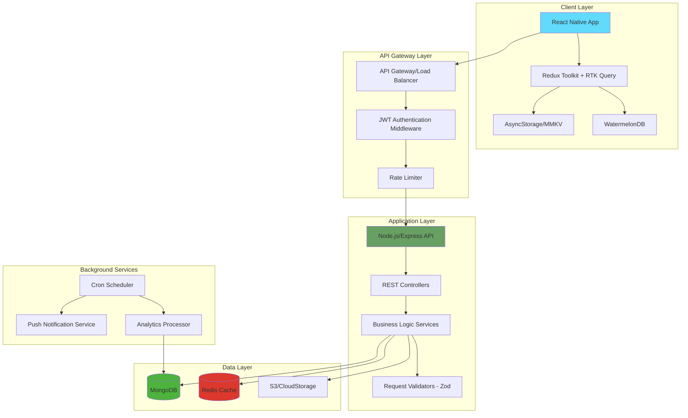
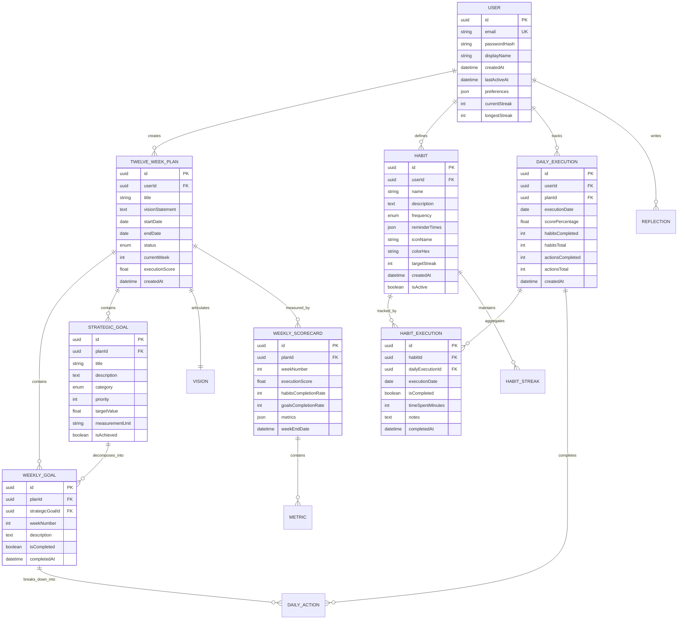
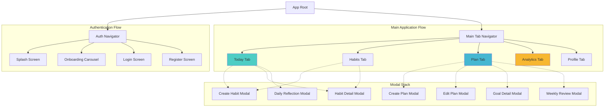
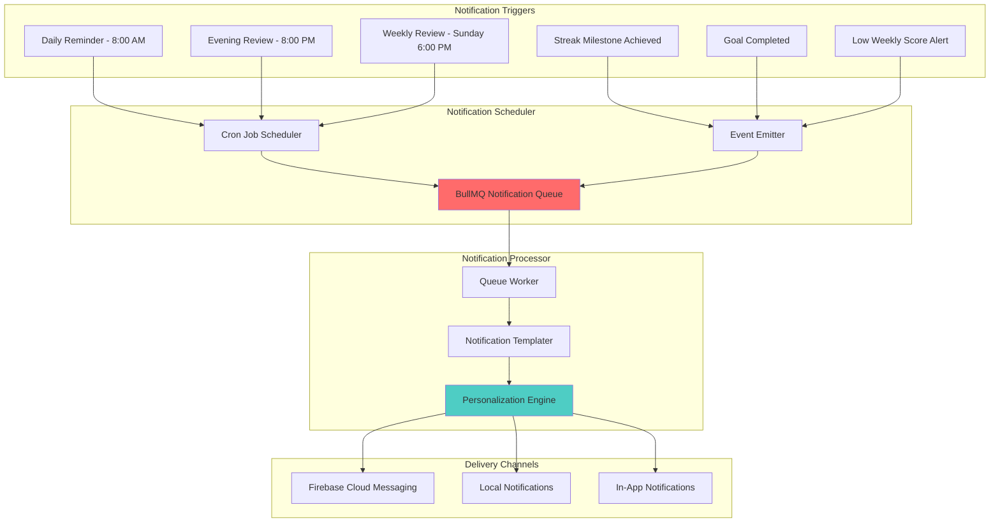
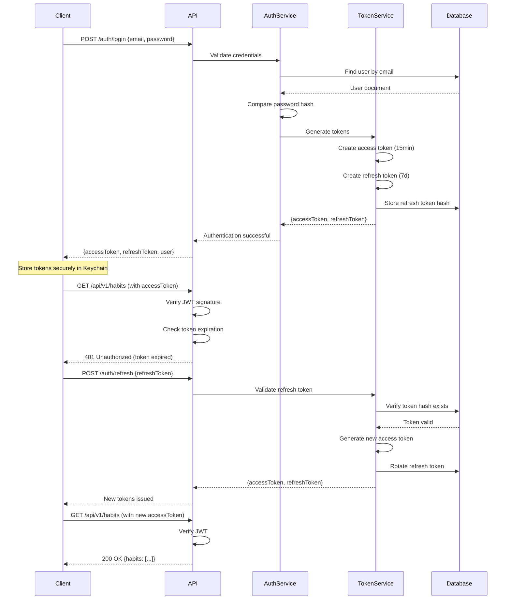
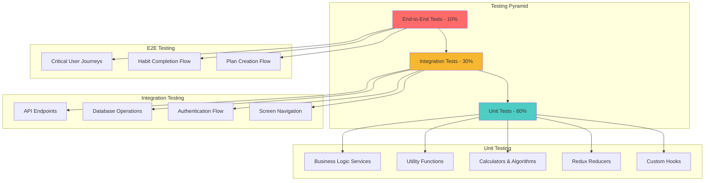

# Comprehensive Technical Specification: Momentum12 - 12 Week Year Habit Tracking System

## Executive Summary

Momentum12 is a sophisticated mobile application implementing the proven 12 Week Year methodology, enabling users to compress annual goal achievement into quarterly sprints through rigorous habit tracking, performance measurement, and accountability mechanisms. The application leverages React Native for cross-platform mobile development, Node.js/TypeScript backend with RESTful architecture, and employs advanced UX patterns including micro-interactions, contextual animations, and progressive disclosure to maximize user engagement and goal attainment.

---

## 1. Architectural Foundation

### 1.1 System Architecture Overview



### 1.2 Technology Stack Specification

**Frontend (React Native)**
- **Framework**: React Native 0.73+ with New Architecture (Fabric + TurboModules)
- **Language**: TypeScript 5.3+ with strict mode enabled
- **State Management**: Redux Toolkit with RTK Query for server state
- **Local Database**: WatermelonDB for offline-first persistence
- **Storage**: MMKV for high-performance key-value storage
- **Navigation**: React Navigation 6+ with native stack navigators
- **Animation**: Reanimated 3+ with Gesture Handler for fluid interactions
- **UI Components**: Custom component library built on Tamagui/NativeWind
- **Forms**: React Hook Form with Zod schema validation
- **Charts**: Victory Native for performance visualization

**Backend (Node.js)**
- **Runtime**: Node.js 20 LTS with ES Modules
- **Framework**: Express.js 4.18+ with TypeScript
- **Language**: TypeScript 5.3+ with strict compilation
- **Database ORM**: Mongoose 8+ for MongoDB interactions
- **Validation**: Zod for runtime type validation
- **Authentication**: JWT with refresh token rotation
- **Caching**: Redis 7+ for session and query caching
- **Job Processing**: BullMQ for background task execution
- **API Documentation**: OpenAPI 3.1 with Swagger UI
- **Testing**: Jest + Supertest for comprehensive coverage

---

## 2. Domain Model & Data Architecture

### 2.1 Core Domain Entities



### 2.2 MongoDB Schema Definitions

```typescript
// User Document Schema
interface IUserDocument {
  _id: mongoose.Types.ObjectId;
  email: string;
  passwordHash: string;
  displayName: string;
  profile: {
    avatarUrl?: string;
    timezone: string;
    weekStartDay: 'monday' | 'sunday';
    preferredUnits: 'metric' | 'imperial';
  };
  preferences: {
    notifications: {
      dailyReminder: boolean;
      weeklyReview: boolean;
      streakMilestones: boolean;
      reminderTime: string; // HH:mm format
    };
    theme: 'light' | 'dark' | 'auto';
    hapticFeedback: boolean;
  };
  statistics: {
    currentStreak: number;
    longestStreak: number;
    totalHabitsCompleted: number;
    totalPlansCreated: number;
    averageWeeklyScore: number;
  };
  createdAt: Date;
  lastActiveAt: Date;
  refreshTokens: string[];
}

// 12 Week Plan Document Schema
interface ITwelveWeekPlanDocument {
  _id: mongoose.Types.ObjectId;
  userId: mongoose.Types.ObjectId;
  title: string;
  visionStatement: string;
  startDate: Date;
  endDate: Date;
  status: 'draft' | 'active' | 'completed' | 'abandoned';
  currentWeek: number;
  strategicGoals: {
    _id: mongoose.Types.ObjectId;
    title: string;
    description: string;
    category: 'health' | 'career' | 'relationships' | 'finance' | 'personal' | 'learning';
    priority: number;
    measurement: {
      targetValue: number;
      currentValue: number;
      unit: string;
    };
    isAchieved: boolean;
    achievedAt?: Date;
  }[];
  weeklyGoals: {
    _id: mongoose.Types.ObjectId;
    strategicGoalId: mongoose.Types.ObjectId;
    weekNumber: number;
    description: string;
    isCompleted: boolean;
    completedAt?: Date;
  }[];
  executionMetrics: {
    overallScore: number;
    weeklyScores: number[];
    habitCompletionRate: number;
    goalCompletionRate: number;
  };
  createdAt: Date;
  updatedAt: Date;
}

// Habit Document Schema
interface IHabitDocument {
  _id: mongoose.Types.ObjectId;
  userId: mongoose.Types.ObjectId;
  planId?: mongoose.Types.ObjectId;
  name: string;
  description?: string;
  frequency: {
    type: 'daily' | 'weekly' | 'custom';
    daysOfWeek?: number[]; // 0-6, Sunday-Saturday
    timesPerWeek?: number;
  };
  reminders: {
    enabled: boolean;
    times: string[]; // HH:mm format
    sound: string;
  };
  appearance: {
    iconName: string;
    colorHex: string;
    emoji?: string;
  };
  streakData: {
    currentStreak: number;
    longestStreak: number;
    targetStreak: number;
    lastCompletedDate?: Date;
  };
  statistics: {
    totalCompletions: number;
    averageTimeSpent: number;
    completionRate: number;
  };
  isActive: boolean;
  createdAt: Date;
  updatedAt: Date;
}

// Daily Execution Document Schema
interface IDailyExecutionDocument {
  _id: mongoose.Types.ObjectId;
  userId: mongoose.Types.ObjectId;
  planId: mongoose.Types.ObjectId;
  executionDate: Date;
  habitExecutions: {
    habitId: mongoose.Types.ObjectId;
    isCompleted: boolean;
    completedAt?: Date;
    timeSpentMinutes?: number;
    intensityRating?: number; // 1-5
    notes?: string;
  }[];
  dailyActions: {
    _id: mongoose.Types.ObjectId;
    weeklyGoalId: mongoose.Types.ObjectId;
    description: string;
    isCompleted: boolean;
    completedAt?: Date;
  }[];
  scorecard: {
    habitsScore: number;
    actionsScore: number;
    overallScore: number;
  };
  reflection?: {
    wins: string;
    challenges: string;
    learnings: string;
    gratitude?: string;
  };
  createdAt: Date;
  updatedAt: Date;
}
```

---

## 3. Application Layer Architecture

### 3.1 Backend Service Architecture

```mermaid
graph TB
    subgraph "API Controllers"
        AuthCtrl[Authentication Controller]
        UserCtrl[User Controller]
        PlanCtrl[Plan Controller]
        HabitCtrl[Habit Controller]
        ExecutionCtrl[Execution Controller]
        AnalyticsCtrl[Analytics Controller]
    end
    
    subgraph "Business Logic Services"
        AuthSvc[Authentication Service]
        UserSvc[User Service]
        PlanSvc[Plan Management Service]
        HabitSvc[Habit Management Service]
        ExecutionSvc[Execution Tracking Service]
        ScorecardSvc[Scorecard Calculation Service]
        StreakSvc[Streak Calculation Service]
        NotificationSvc[Notification Service]
    end
    
    subgraph "Data Access Layer"
        UserRepo[User Repository]
        PlanRepo[Plan Repository]
        HabitRepo[Habit Repository]
        ExecutionRepo[Execution Repository]
    end
    
    subgraph "External Services"
        FCM[Firebase Cloud Messaging]
        Email[Email Service - SendGrid]
        FileStorage[S3 Storage Service]
    end
    
    AuthCtrl --> AuthSvc
    UserCtrl --> UserSvc
    PlanCtrl --> PlanSvc
    HabitCtrl --> HabitSvc
    ExecutionCtrl --> ExecutionSvc
    ExecutionCtrl --> ScorecardSvc
    
    AuthSvc --> UserRepo
    UserSvc --> UserRepo
    PlanSvc --> PlanRepo
    HabitSvc --> HabitRepo
    ExecutionSvc --> ExecutionRepo
    ExecutionSvc --> StreakSvc
    
    ScorecardSvc --> ExecutionRepo
    ScorecardSvc --> PlanRepo
    
    NotificationSvc --> FCM
    UserSvc --> Email
    UserSvc --> FileStorage
    
    style AuthSvc fill:#ff6b6b
    style ExecutionSvc fill:#4ecdc4
    style ScorecardSvc fill:#45b7d1
```



### 3.2 Core API Endpoints Specification

```typescript
/**
 * Authentication & User Management Endpoints
 */
POST   /api/v1/auth/register
POST   /api/v1/auth/login
POST   /api/v1/auth/refresh
POST   /api/v1/auth/logout
POST   /api/v1/auth/forgot-password
POST   /api/v1/auth/reset-password

GET    /api/v1/users/profile
PATCH  /api/v1/users/profile
PATCH  /api/v1/users/preferences
GET    /api/v1/users/statistics
DELETE /api/v1/users/account

/**
 * 12 Week Plan Management Endpoints
 */
POST   /api/v1/plans
GET    /api/v1/plans
GET    /api/v1/plans/:planId
PATCH  /api/v1/plans/:planId
DELETE /api/v1/plans/:planId
POST   /api/v1/plans/:planId/strategic-goals
PATCH  /api/v1/plans/:planId/strategic-goals/:goalId
DELETE /api/v1/plans/:planId/strategic-goals/:goalId
POST   /api/v1/plans/:planId/weekly-goals
PATCH  /api/v1/plans/:planId/weekly-goals/:goalId
GET    /api/v1/plans/:planId/scorecard
GET    /api/v1/plans/:planId/progress

/**
 * Habit Management Endpoints
 */
POST   /api/v1/habits
GET    /api/v1/habits
GET    /api/v1/habits/:habitId
PATCH  /api/v1/habits/:habitId
DELETE /api/v1/habits/:habitId
GET    /api/v1/habits/:habitId/statistics
GET    /api/v1/habits/:habitId/history

/**
 * Daily Execution & Tracking Endpoints
 */
POST   /api/v1/executions
GET    /api/v1/executions/today
GET    /api/v1/executions/:date
PATCH  /api/v1/executions/:executionId
POST   /api/v1/executions/:executionId/habits/:habitId/complete
POST   /api/v1/executions/:executionId/habits/:habitId/uncomplete
POST   /api/v1/executions/:executionId/actions/:actionId/complete
POST   /api/v1/executions/:executionId/reflection

/**
 * Analytics & Reporting Endpoints
 */
GET    /api/v1/analytics/dashboard
GET    /api/v1/analytics/trends
GET    /api/v1/analytics/weekly-report/:weekNumber
GET    /api/v1/analytics/completion-heatmap
GET    /api/v1/analytics/habit-correlation
```

### 3.3 Request/Response DTOs

```typescript
// Plan Creation Request DTO
interface CreatePlanRequestDTO {
  title: string; // min: 3, max: 100
  visionStatement: string; // min: 20, max: 1000
  startDate: string; // ISO date
  strategicGoals: {
    title: string;
    description: string;
    category: GoalCategory;
    priority: number; // 1-5
    measurement: {
      targetValue: number;
      unit: string;
    };
  }[];
}

// Habit Creation Request DTO
interface CreateHabitRequestDTO {
  name: string; // min: 2, max: 50
  description?: string; // max: 500
  planId?: string; // UUID
  frequency: {
    type: 'daily' | 'weekly' | 'custom';
    daysOfWeek?: number[];
    timesPerWeek?: number;
  };
  reminders: {
    enabled: boolean;
    times: string[];
  };
  appearance: {
    iconName: string;
    colorHex: string;
  };
  targetStreak: number;
}

// Daily Execution Response DTO
interface DailyExecutionResponseDTO {
  id: string;
  executionDate: string;
  planId: string;
  planTitle: string;
  habitExecutions: {
    habitId: string;
    habitName: string;
    iconName: string;
    colorHex: string;
    isCompleted: boolean;
    completedAt?: string;
    currentStreak: number;
  }[];
  dailyActions: {
    id: string;
    description: string;
    isCompleted: boolean;
    linkedGoal: {
      id: string;
      title: string;
    };
  }[];
  scorecard: {
    habitsScore: number;
    actionsScore: number;
    overallScore: number;
  };
  weekProgress: {
    currentWeek: number;
    totalWeeks: number;
    weeklyScore: number;
  };
}

// Analytics Dashboard Response DTO
interface AnalyticsDashboardDTO {
  currentPlan: {
    id: string;
    title: string;
    currentWeek: number;
    daysRemaining: number;
    overallScore: number;
  };
  streakData: {
    currentStreak: number;
    longestStreak: number;
    streakHistory: { date: string; maintained: boolean }[];
  };
  weeklyTrend: {
    weekNumber: number;
    score: number;
    habitsCompleted: number;
    goalsCompleted: number;
  }[];
  habitPerformance: {
    habitId: string;
    habitName: string;
    completionRate: number;
    currentStreak: number;
    trend: 'improving' | 'stable' | 'declining';
  }[];
  goalProgress: {
    goalId: string;
    title: string;
    category: string;
    progressPercentage: number;
    isOnTrack: boolean;
  }[];
}
```

---

## 4. Frontend Architecture & Navigation

### 4.1 Navigation Structure



### 4.2 Screen Component Architecture

```typescript
/**
 * Today Screen Component Structure
 */
interface TodayScreenProps {
  navigation: NavigationProp<MainTabParamList, 'Today'>;
  route: RouteProp<MainTabParamList, 'Today'>;
}

const TodayScreen: React.FC<TodayScreenProps> = ({ navigation }) => {
  // Component implementation with sections:
  // 1. Header with date, streak, and score
  // 2. Daily motivational quote
  // 3. Habit checklist with completion animation
  // 4. Daily actions from weekly goals
  // 5. Quick stats summary
  // 6. FAB for adding quick habit
};

/**
 * Plan Screen Component Structure
 */
interface PlanScreenProps {
  navigation: NavigationProp<MainTabParamList, 'Plan'>;
}

const PlanScreen: React.FC<PlanScreenProps> = ({ navigation }) => {
  // Component implementation with sections:
  // 1. Plan header with countdown and progress
  // 2. Week selector carousel
  // 3. Strategic goals cards with progress
  // 4. Weekly goals checklist
  // 5. Weekly scorecard visualization
};

/**
 * Analytics Screen Component Structure
 */
interface AnalyticsScreenProps {
  navigation: NavigationProp<MainTabParamList, 'Analytics'>;
}

const AnalyticsScreen: React.FC<AnalyticsScreenProps> = ({ navigation }) => {
  // Component implementation with sections:
  // 1. Time range selector (Week/Month/12 Weeks)
  // 2. Key metrics cards (Score, Completion, Streak)
  // 3. Execution score line chart
  // 4. Habit performance comparison
  // 5. Category breakdown pie chart
  // 6. Insights and recommendations
};
```

### 4.3 State Management Architecture

```typescript
/**
 * Redux Store Structure
 */
interface RootState {
  auth: AuthState;
  user: UserState;
  plans: PlansState;
  habits: HabitsState;
  executions: ExecutionsState;
  analytics: AnalyticsState;
  ui: UIState;
}

/**
 * Auth State Slice
 */
interface AuthState {
  isAuthenticated: boolean;
  accessToken: string | null;
  refreshToken: string | null;
  tokenExpiry: number | null;
  isLoading: boolean;
  error: string | null;
}

/**
 * Plans State Slice
 */
interface PlansState {
  activePlan: ITwelveWeekPlan | null;
  planHistory: ITwelveWeekPlan[];
  currentWeek: number;
  isLoading: boolean;
  error: string | null;
}

/**
 * Habits State Slice
 */
interface HabitsState {
  habits: IHabit[];
  habitsById: Record<string, IHabit>;
  activeHabits: string[];
  isLoading: boolean;
  error: string | null;
}

/**
 * Executions State Slice
 */
interface ExecutionsState {
  todayExecution: IDailyExecution | null;
  executionHistory: Record<string, IDailyExecution>; // date -> execution
  currentStreak: number;
  todayScore: number;
  isLoading: boolean;
  error: string | null;
}

/**
 * RTK Query API Definitions
 */
const api = createApi({
  reducerPath: 'api',
  baseQuery: baseQueryWithReauth,
  tagTypes: ['User', 'Plans', 'Habits', 'Executions', 'Analytics'],
  endpoints: (builder) => ({
    // Authentication
    login: builder.mutation<LoginResponse, LoginRequest>({...}),
    register: builder.mutation<RegisterResponse, RegisterRequest>({...}),
    
    // Plans
    getActivePlan: builder.query<PlanResponse, void>({...}),
    createPlan: builder.mutation<PlanResponse, CreatePlanRequest>({...}),
    updatePlan: builder.mutation<PlanResponse, UpdatePlanRequest>({...}),
    
    // Habits
    getHabits: builder.query<HabitsResponse, void>({...}),
    createHabit: builder.mutation<HabitResponse, CreateHabitRequest>({...}),
    updateHabit: builder.mutation<HabitResponse, UpdateHabitRequest>({...}),
    
    // Executions
    getTodayExecution: builder.query<ExecutionResponse, void>({...}),
    completeHabit: builder.mutation<void, CompleteHabitRequest>({...}),
    completeAction: builder.mutation<void, CompleteActionRequest>({...}),
    
    // Analytics
    getDashboard: builder.query<DashboardResponse, void>({...}),
    getWeeklyReport: builder.query<WeeklyReportResponse, number>({...}),
  }),
});
```

---

## 5. User Interface & Experience Design

### 5.1 Design System Specification

```typescript
/**
 * Color Palette - Modern, Motivational Theme
 */
const colors = {
  // Primary brand colors
  primary: {
    50: '#E3F2FD',
    100: '#BBDEFB',
    500: '#2196F3', // Main brand color
    600: '#1E88E5',
    700: '#1976D2',
  },
  
  // Success/Achievement colors
  success: {
    50: '#E8F5E9',
    500: '#4CAF50',
    700: '#388E3C',
  },
  
  // Warning/Attention colors
  warning: {
    50: '#FFF3E0',
    500: '#FF9800',
    700: '#F57C00',
  },
  
  // Danger/Error colors
  danger: {
    50: '#FFEBEE',
    500: '#F44336',
    700: '#D32F2F',
  },
  
  // Neutral colors
  gray: {
    50: '#FAFAFA',
    100: '#F5F5F5',
    200: '#EEEEEE',
    300: '#E0E0E0',
    400: '#BDBDBD',
    500: '#9E9E9E',
    600: '#757575',
    700: '#616161',
    800: '#424242',
    900: '#212121',
  },
  
  // Semantic colors
  background: {
    light: '#FFFFFF',
    dark: '#121212',
  },
  surface: {
    light: '#F8F9FA',
    dark: '#1E1E1E',
  },
  text: {
    primary: {
      light: '#212121',
      dark: '#FFFFFF',
    },
    secondary: {
      light: '#757575',
      dark: '#BDBDBD',
    },
  },
};

/**
 * Typography System
 */
const typography = {
  fontFamily: {
    primary: 'Inter', // Main UI font
    display: 'Poppins', // Headers and emphasis
    mono: 'JetBrains Mono', // Numbers and code
  },
  
  fontSize: {
    xs: 12,
    sm: 14,
    base: 16,
    lg: 18,
    xl: 20,
    '2xl': 24,
    '3xl': 30,
    '4xl': 36,
    '5xl': 48,
  },
  
  fontWeight: {
    regular: '400',
    medium: '500',
    semibold: '600',
    bold: '700',
    extrabold: '800',
  },
  
  lineHeight: {
    tight: 1.2,
    normal: 1.5,
    relaxed: 1.75,
  },
};

/**
 * Spacing System (8px base grid)
 */
const spacing = {
  xs: 4,
  sm: 8,
  md: 16,
  lg: 24,
  xl: 32,
  '2xl': 48,
  '3xl': 64,
};

/**
 * Border Radius System
 */
const borderRadius = {
  sm: 4,
  md: 8,
  lg: 12,
  xl: 16,
  '2xl': 24,
  full: 9999,
};

/**
 * Shadow System
 */
const shadows = {
  sm: {
    shadowColor: '#000',
    shadowOffset: { width: 0, height: 1 },
    shadowOpacity: 0.05,
    shadowRadius: 2,
    elevation: 1,
  },
  md: {
    shadowColor: '#000',
    shadowOffset: { width: 0, height: 2 },
    shadowOpacity: 0.08,
    shadowRadius: 4,
    elevation: 3,
  },
  lg: {
    shadowColor: '#000',
    shadowOffset: { width: 0, height: 4 },
    shadowOpacity: 0.12,
    shadowRadius: 8,
    elevation: 6,
  },
};
```

### 5.2 Key UI Components Specification

```typescript
/**
 * Habit Completion Card Component
 */
interface HabitCardProps {
  habit: IHabit;
  isCompleted: boolean;
  currentStreak: number;
  onToggle: () => void;
  onPress: () => void;
}

const HabitCard: React.FC<HabitCardProps> = ({
  habit,
  isCompleted,
  currentStreak,
  onToggle,
  onPress,
}) => {
  const checkmarkScale = useSharedValue(1);
  const cardScale = useSharedValue(1);
  
  const animatedCheckmarkStyle = useAnimatedStyle(() => ({
    transform: [{ scale: checkmarkScale.value }],
  }));
  
  const handleToggle = () => {
    // Spring animation on completion
    checkmarkScale.value = withSequence(
      withSpring(1.3, { damping: 10 }),
      withSpring(1)
    );
    onToggle();
  };
  
  return (
    <Pressable
      onPress={onPress}
      onPressIn={() => { cardScale.value = withSpring(0.98); }}
      onPressOut={() => { cardScale.value = withSpring(1); }}
    >
      <View style={[styles.card, { transform: [{ scale: cardScale.value }] }]}>
        {/* Habit icon and name */}
        {/* Streak indicator */}
        {/* Completion checkbox with animation */}
      </View>
    </Pressable>
  );
};

/**
 * Circular Progress Indicator Component
 */
interface CircularProgressProps {
  progress: number; // 0-100
  size: number;
  strokeWidth: number;
  color: string;
  showPercentage?: boolean;
}

const CircularProgress: React.FC<CircularProgressProps> = ({
  progress,
  size,
  strokeWidth,
  color,
  showPercentage = true,
}) => {
  const animatedProgress = useSharedValue(0);
  
  useEffect(() => {
    animatedProgress.value = withTiming(progress, {
      duration: 1000,
      easing: Easing.bezier(0.25, 0.1, 0.25, 1),
    });
  }, [progress]);
  
  // SVG circle implementation with animated stroke-dashoffset
  return (
    <View style={[styles.container, { width: size, height: size }]}>
      <Svg width={size} height={size}>
        {/* Background circle */}
        {/* Animated progress circle */}
      </Svg>
      {showPercentage && (
        <View style={styles.percentageContainer}>
          <Text style={styles.percentageText}>{Math.round(progress)}%</Text>
        </View>
      )}
    </View>
  );
};

/**
 * Weekly Scorecard Component
 */
interface WeeklyScorecardProps {
  weekNumber: number;
  weeklyGoals: IWeeklyGoal[];
  habitCompletions: Record<string, number>;
  overallScore: number;
}

const WeeklyScorecard: React.FC<WeeklyScorecardProps> = ({
  weekNumber,
  weeklyGoals,
  habitCompletions,
  overallScore,
}) => {
  return (
    <View style={styles.scorecard}>
      <View style={styles.header}>
        <Text style={styles.weekTitle}>Week {weekNumber}</Text>
        <CircularProgress
          progress={overallScore}
          size={60}
          strokeWidth={6}
          color={colors.primary[500]}
        />
      </View>
      
      <View style={styles.metrics}>
        <MetricRow
          label="Goals Completed"
          value={`${weeklyGoals.filter(g => g.isCompleted).length}/${weeklyGoals.length}`}
        />
        <MetricRow
          label="Habit Completion"
          value={`${calculateAverageCompletion(habitCompletions)}%`}
        />
      </View>
      
      <View style={styles.goalsList}>
        {weeklyGoals.map(goal => (
          <GoalItem key={goal.id} goal={goal} />
        ))}
      </View>
    </View>
  );
};
```

### 5.3 Animation & Interaction Specifications

```typescript
/**
 * Micro-interactions and Gestures
 */

// 1. Habit Completion Animation
const useHabitCompletionAnimation = () => {
  const scale = useSharedValue(1);
  const opacity = useSharedValue(1);
  
  const triggerCompletion = useCallback(() => {
    // Haptic feedback
    Haptics.impactAsync(Haptics.ImpactFeedbackStyle.Medium);
    
    // Scale and fade animation
    scale.value = withSequence(
      withSpring(1.2, { damping: 8 }),
      withSpring(1, { damping: 10 })
    );
    
    // Confetti particle emission (using react-native-confetti-cannon)
    confettiRef.current?.start();
  }, []);
  
  return { scale, opacity, triggerCompletion };
};

// 2. Swipe to Delete Gesture
const useSwipeToDeleteGesture = (onDelete: () => void) => {
  const translateX = useSharedValue(0);
  const itemHeight = useSharedValue(ITEM_HEIGHT);
  
  const gestureHandler = useAnimatedGestureHandler({
    onActive: (event) => {
      translateX.value = Math.min(0, event.translationX);
    },
    onEnd: (event) => {
      if (event.translationX < -100) {
        // Trigger delete animation
        translateX.value = withTiming(-SCREEN_WIDTH, { duration: 300 });
        itemHeight.value = withTiming(0, { duration: 300 }, () => {
          runOnJS(onDelete)();
        });
      } else {
        // Snap back
        translateX.value = withSpring(0);
      }
    },
  });
  
  return { translateX, itemHeight, gestureHandler };
};

// 3. Pull to Refresh Animation
const usePullToRefresh = (onRefresh: () => Promise<void>) => {
  const refreshing = useSharedValue(false);
  const scrollY = useSharedValue(0);
  
  const onScroll = useAnimatedScrollHandler({
    onScroll: (event) => {
      scrollY.value = event.contentOffset.y;
    },
  });
  
  const handleRefresh = async () => {
    refreshing.value = true;
    await onRefresh();
    refreshing.value = false;
  };
  
  return { refreshing, scrollY, onScroll, handleRefresh };
};

// 4. Streak Counter Animation
const useStreakAnimation = (streak: number) => {
  const scale = useSharedValue(1);
  const rotation = useSharedValue(0);
  
  useEffect(() => {
    if (streak > 0) {
      // Celebration animation for streak milestones
      if (streak % 7 === 0) {
        rotation.value = withSequence(
          withTiming(10, { duration: 100 }),
          withTiming(-10, { duration: 100 }),
          withTiming(0, { duration: 100 })
        );
        scale.value = withSequence(
          withSpring(1.3),
          withSpring(1)
        );
        Haptics.notificationAsync(Haptics.NotificationFeedbackType.Success);
      }
    }
  }, [streak]);
  
  return { scale, rotation };
};
```

---

## 6. Advanced Features Specification

### 6.1 Scorecard Calculation Algorithm

```typescript
/**
 * Weekly Execution Score Calculation
 * Based on 12 Week Year methodology
 */
class ScorecardCalculator {
  /**
   * Calculate weekly execution score
   * Formula: (Completed Actions / Total Required Actions) × 100
   */
  calculateWeeklyScore(
    weeklyGoals: IWeeklyGoal[],
    habitExecutions: IHabitExecution[],
    daysInWeek: number
  ): number {
    // Calculate goal completion score (40% weight)
    const goalScore = this.calculateGoalCompletionScore(weeklyGoals);
    
    // Calculate habit adherence score (60% weight)
    const habitScore = this.calculateHabitAdherenceScore(
      habitExecutions,
      daysInWeek
    );
    
    // Weighted average
    const overallScore = (goalScore * 0.4) + (habitScore * 0.6);
    
    return Math.round(overallScore * 100) / 100;
  }
  
  private calculateGoalCompletionScore(weeklyGoals: IWeeklyGoal[]): number {
    if (weeklyGoals.length === 0) return 100;
    
    const completedGoals = weeklyGoals.filter(g => g.isCompleted).length;
    return (completedGoals / weeklyGoals.length) * 100;
  }
  
  private calculateHabitAdherenceScore(
    habitExecutions: IHabitExecution[],
    daysInWeek: number
  ): number {
    // Group executions by habit
    const executionsByHabit = this.groupExecutionsByHabit(habitExecutions);
    
    let totalAdherence = 0;
    const habitCount = Object.keys(executionsByHabit).length;
    
    if (habitCount === 0) return 100;
    
    for (const [habitId, executions] of Object.entries(executionsByHabit)) {
      const completedDays = executions.filter(e => e.isCompleted).length;
      const adherenceRate = (completedDays / daysInWeek) * 100;
      totalAdherence += adherenceRate;
    }
    
    return totalAdherence / habitCount;
  }
  
  /**
   * Calculate 12-week execution score
   * This is the cumulative average of all weekly scores
   */
  calculate12WeekScore(weeklyScores: number[]): number {
    if (weeklyScores.length === 0) return 0;
    
    const sum = weeklyScores.reduce((acc, score) => acc + score, 0);
    return Math.round((sum / weeklyScores.length) * 100) / 100;
  }
  
  /**
   * Determine if user is "on track" for goal achievement
   * On track = maintaining ≥85% execution score
   */
  isOnTrack(executionScore: number): boolean {
    return executionScore >= 85;
  }
  
  /**
   * Calculate streak based on consecutive habit completions
   */
  calculateStreak(habitExecutions: IHabitExecution[]): {
    currentStreak: number;
    longestStreak: number;
  } {
    const sortedExecutions = habitExecutions
      .sort((a, b) => 
        new Date(b.executionDate).getTime() - 
        new Date(a.executionDate).getTime()
      );
    
    let currentStreak = 0;
    let longestStreak = 0;
    let tempStreak = 0;
    
    for (let i = 0; i < sortedExecutions.length; i++) {
      const execution = sortedExecutions[i];
      
      if (execution.isCompleted) {
        tempStreak++;
        if (i === 0) currentStreak = tempStreak;
        longestStreak = Math.max(longestStreak, tempStreak);
      } else {
        if (i === 0) currentStreak = 0;
        tempStreak = 0;
      }
    }
    
    return { currentStreak, longestStreak };
  }
}
```

### 6.2 Notification System Architecture



### 6.3 Offline-First Synchronization Strategy

```typescript
/**
 * Offline-First Data Synchronization Architecture
 */

// WatermelonDB Schema Definition
const habitSchema = tableSchema({
  name: 'habits',
  columns: [
    { name: 'server_id', type: 'string', isOptional: true },
    { name: 'name', type: 'string' },
    { name: 'description', type: 'string', isOptional: true },
    { name: 'frequency_type', type: 'string' },
    { name: 'icon_name', type: 'string' },
    { name: 'color_hex', type: 'string' },
    { name: 'is_active', type: 'boolean' },
    { name: 'is_synced', type: 'boolean' },
    { name: 'created_at', type: 'number' },
    { name: 'updated_at', type: 'number' },
  ],
});

// Synchronization Service
class SyncService {
  private syncQueue: SyncOperation[] = [];
  private isSyncing: boolean = false;
  
  /**
   * Queue offline operation for later sync
   */
  async queueOperation(operation: SyncOperation): Promise<void> {
    this.syncQueue.push(operation);
    await this.persistQueue();
    
    // Attempt immediate sync if online
    if (await this.isOnline()) {
      this.syncNow();
    }
  }
  
  /**
   * Sync all pending operations when connection restored
   */
  async syncNow(): Promise<void> {
    if (this.isSyncing || this.syncQueue.length === 0) return;
    
    this.isSyncing = true;
    
    try {
      // Sort operations by timestamp
      const sortedOps = this.sortOperationsByDependency(this.syncQueue);
      
      for (const operation of sortedOps) {
        await this.executeOperation(operation);
        this.removeFromQueue(operation);
      }
      
      // Pull latest data from server
      await this.pullServerChanges();
      
      console.log('Sync completed successfully');
    } catch (error) {
      console.error('Sync failed:', error);
      // Keep failed operations in queue for retry
    } finally {
      this.isSyncing = false;
    }
  }
  
  /**
   * Execute individual sync operation
   */
  private async executeOperation(operation: SyncOperation): Promise<void> {
    switch (operation.type) {
      case 'CREATE_HABIT':
        await this.syncCreateHabit(operation.data);
        break;
      case 'UPDATE_HABIT':
        await this.syncUpdateHabit(operation.data);
        break;
      case 'COMPLETE_HABIT':
        await this.syncCompleteHabit(operation.data);
        break;
      case 'CREATE_PLAN':
        await this.syncCreatePlan(operation.data);
        break;
      // ... other operation types
    }
  }
  
  /**
   * Conflict resolution strategy
   * Server wins for user profile/preferences
   * Client wins for executions (if timestamps are recent)
   * Manual resolution required for strategic goals/plans
   */
  private async resolveConflict(
    localData: any,
    serverData: any,
    entityType: string
  ): Promise<any> {
    if (entityType === 'execution') {
      // Client wins for recent executions
      return localData.updatedAt > serverData.updatedAt
        ? localData
        : serverData;
    } else if (entityType === 'profile') {
      // Server wins for profile
      return serverData;
    } else {
      // Flag for manual resolution
      return this.flagConflictForResolution(localData, serverData);
    }
  }
}
```

---

## 7. Security & Performance Specifications

### 7.1 Authentication & Authorization Flow



### 7.2 Performance Optimization Strategies

```typescript
/**
 * Performance Optimization Implementations
 */

// 1. Image Lazy Loading with Progressive Enhancement
const OptimizedImage: React.FC<ImageProps> = ({ uri, ...props }) => {
  const [loading, setLoading] = useState(true);
  const opacity = useSharedValue(0);
  
  const animatedStyle = useAnimatedStyle(() => ({
    opacity: opacity.value,
  }));
  
  return (
    <View>
      {loading && <Skeleton />}
      <Animated.Image
        {...props}
        source={{ uri }}
        style={[props.style, animatedStyle]}
        onLoadEnd={() => {
          setLoading(false);
          opacity.value = withTiming(1, { duration: 300 });
        }}
      />
    </View>
  );
};

// 2. List Virtualization with FlashList
import { FlashList } from '@shopify/flash-list';

const HabitsList: React.FC<HabitsListProps> = ({ habits }) => {
  const renderItem = useCallback(({ item }: { item: IHabit }) => (
    <HabitCard key={item.id} habit={item} />
  ), []);
  
  return (
    <FlashList
      data={habits}
      renderItem={renderItem}
      estimatedItemSize={80}
      keyExtractor={(item) => item.id}
      removeClippedSubviews={true}
      maxToRenderPerBatch={10}
      updateCellsBatchingPeriod={50}
      windowSize={21}
    />
  );
};

// 3. Debounced Search with useMemo
const useDebounce = <T,>(value: T, delay: number): T => {
  const [debouncedValue, setDebouncedValue] = useState(value);
  
  useEffect(() => {
    const handler = setTimeout(() => {
      setDebouncedValue(value);
    }, delay);
    
    return () => clearTimeout(handler);
  }, [value, delay]);
  
  return debouncedValue;
};

// 4. React Query for Server State Caching
import { useQuery, useMutation, useQueryClient } from '@tanstack/react-query';

const useHabits = () => {
  return useQuery({
    queryKey: ['habits'],
    queryFn: fetchHabits,
    staleTime: 5 * 60 * 1000, // 5 minutes
    cacheTime: 30 * 60 * 1000, // 30 minutes
    refetchOnWindowFocus: false,
  });
};

// 5. Code Splitting with Dynamic Imports
const AnalyticsScreen = React.lazy(() => import('./screens/AnalyticsScreen'));
const PlanScreen = React.lazy(() => import('./screens/PlanScreen'));

// 6. Memory Leak Prevention
useEffect(() => {
  let isMounted = true;
  
  const subscription = eventEmitter.on('habitCompleted', (data) => {
    if (isMounted) {
      updateState(data);
    }
  });
  
  return () => {
    isMounted = false;
    subscription.remove();
  };
}, []);
```

### 7.3 Database Indexing Strategy

```typescript
/**
 * MongoDB Index Specifications for Performance
 */

// User Collection Indexes
db.users.createIndex({ email: 1 }, { unique: true });
db.users.createIndex({ createdAt: 1 });
db.users.createIndex({ lastActiveAt: -1 });

// Plans Collection Indexes
db.plans.createIndex({ userId: 1, status: 1 });
db.plans.createIndex({ userId: 1, startDate: -1 });
db.plans.createIndex({ status: 1, currentWeek: 1 });
db.plans.createIndex({ 'strategicGoals._id': 1 });

// Habits Collection Indexes
db.habits.createIndex({ userId: 1, isActive: 1 });
db.habits.createIndex({ userId: 1, createdAt: -1 });
db.habits.createIndex({ 'frequency.type': 1, userId: 1 });

// Daily Executions Collection Indexes
db.daily_executions.createIndex({ userId: 1, executionDate: -1 });
db.daily_executions.createIndex({ planId: 1, executionDate: -1 });
db.daily_executions.createIndex(
  { userId: 1, executionDate: -1 },
  { partialFilterExpression: { 'scorecard.overallScore': { $gte: 85 } } }
);

// Compound indexes for complex queries
db.daily_executions.createIndex({
  userId: 1,
  executionDate: -1,
  'scorecard.overallScore': -1,
});
```

---

## 8. Testing Strategy

### 8.1 Testing Pyramid



### 8.2 Test Coverage Requirements

```typescript
/**
 * Unit Test Examples
 */

// Scorecard Calculator Tests
describe('ScorecardCalculator', () => {
  let calculator: ScorecardCalculator;
  
  beforeEach(() => {
    calculator = new ScorecardCalculator();
  });
  
  describe('calculateWeeklyScore', () => {
    it('should return 100 when all goals and habits are completed', () => {
      const weeklyGoals = [
        { id: '1', isCompleted: true },
        { id: '2', isCompleted: true },
      ];
      const habitExecutions = [
        { habitId: '1', isCompleted: true },
        { habitId: '1', isCompleted: true },
      ];
      
      const score = calculator.calculateWeeklyScore(
        weeklyGoals,
        habitExecutions,
        7
      );
      
      expect(score).toBe(100);
    });
    
    it('should apply correct weighting (40% goals, 60% habits)', () => {
      const weeklyGoals = [
        { id: '1', isCompleted: true },
        { id: '2', isCompleted: false },
      ]; // 50% completion
      
      const habitExecutions = [
        { habitId: '1', isCompleted: true },
        { habitId: '1', isCompleted: true },
        { habitId: '1', isCompleted: true },
        { habitId: '1', isCompleted: true },
        { habitId: '1', isCompleted: true },
        { habitId: '1', isCompleted: true },
        { habitId: '1', isCompleted: true },
      ]; // 100% completion (7/7 days)
      
      const score = calculator.calculateWeeklyScore(
        weeklyGoals,
        habitExecutions,
        7
      );
      
      // Expected: (50 * 0.4) + (100 * 0.6) = 20 + 60 = 80
      expect(score).toBe(80);
    });
  });
});

/**
 * Integration Test Examples
 */

describe('Habit API Endpoints', () => {
  let authToken: string;
  
  beforeAll(async () => {
    // Setup test database and authenticate
    authToken = await getTestAuthToken();
  });
  
  describe('POST /api/v1/habits', () => {
    it('should create a new habit successfully', async () => {
      const habitData = {
        name: 'Morning Meditation',
        frequency: { type: 'daily' },
        appearance: { iconName: 'meditation', colorHex: '#4CAF50' },
      };
      
      const response = await request(app)
        .post('/api/v1/habits')
        .set('Authorization', `Bearer ${authToken}`)
        .send(habitData)
        .expect(201);
      
      expect(response.body).toHaveProperty('id');
      expect(response.body.name).toBe(habitData.name);
    });
    
    it('should return 400 for invalid habit data', async () => {
      const invalidData = {
        name: 'A', // Too short
      };
      
      const response = await request(app)
        .post('/api/v1/habits')
        .set('Authorization', `Bearer ${authToken}`)
        .send(invalidData)
        .expect(400);
      
      expect(response.body).toHaveProperty('errors');
    });
  });
});

/**
 * E2E Test Examples (Detox)
 */

describe('Habit Completion Flow', () => {
  beforeAll(async () => {
    await device.launchApp();
    await loginTestUser();
  });
  
  it('should complete a habit and update streak', async () => {
    // Navigate to Today screen
    await element(by.id('tab-today')).tap();
    
    // Find and tap habit checkbox
    await element(by.id('habit-checkbox-1')).tap();
    
    // Verify completion animation appears
    await waitFor(element(by.id('completion-animation')))
      .toBeVisible()
      .withTimeout(2000);
    
    // Verify streak counter updated
    await expect(element(by.id('streak-counter'))).toHaveText('1');
    
    // Verify score updated
    await expect(element(by.id('daily-score'))).not.toHaveText('0%');
  });
});
```

---

## 9. Deployment & DevOps

### 9.1 CI/CD Pipeline

```mermaid
graph LR
    subgraph "Development"
        Dev[Developer Commit]
        Branch[Feature Branch]
    end
    
    subgraph "CI Pipeline"
        Lint[ESLint + Prettier]
        TypeCheck[TypeScript Check]
        UnitTest[Unit Tests]
        IntTest[Integration Tests]
    end
    
    subgraph "Build"
        AndroidBuild[Android Build]
        iOSBuild[iOS Build]
        APIStagingBuild[API Staging Build]
    end
    
    subgraph "Testing"
        E2ETest[E2E Tests - Detox]
        SecurityScan[Security Scan]
        PerformanceTest[Performance Tests]
    end
    
    subgraph "Deployment"
        StagingDeploy[Deploy to Staging]
        ProductionDeploy[Deploy to Production]
        AppStoreSubmit[Submit to App Stores]
    end
    
    Dev --> Branch
    Branch --> Lint
    Lint --> TypeCheck
    TypeCheck --> UnitTest
    UnitTest --> IntTest
    IntTest --> AndroidBuild
    IntTest --> iOSBuild
    IntTest --> APIStagingBuild
    
    AndroidBuild --> E2ETest
    iOSBuild --> E2ETest
    APIStagingBuild --> StagingDeploy
    
    E2ETest --> SecurityScan
    SecurityScan --> PerformanceTest
    PerformanceTest --> StagingDeploy
    
    StagingDeploy --> ProductionDeploy
    ProductionDeploy --> AppStoreSubmit
    
    style Lint fill:#61dafb
    style UnitTest fill:#4ecdc4
    style ProductionDeploy fill:#4CAF50
```



---

## 10. Future Enhancements Roadmap

### Phase 2 Features (Post-MVP)
1. **Social Accountability**: Share progress with accountability partners
2. **Team Plans**: Collaborative 12-week plans for teams
3. **AI Coach**: Personalized recommendations based on performance patterns
4. **Habit Stacking**: Smart suggestions for habit combinations
5. **Integration Ecosystem**: Connect with fitness trackers, calendars
6. **Advanced Analytics**: Predictive analytics, correlation analysis
7. **Gamification**: Badges, achievements, leaderboards
8. **Voice Logging**: Voice-based habit completion
9. **Apple Watch/Wear OS**: Companion apps for wearables
10. **Export/Reporting**: PDF reports, CSV exports for external analysis

---

## Conclusion

This comprehensive specification provides a production-ready blueprint for Momentum12, architecting a sophisticated habit tracking application that embodies the transformative principles of the 12 Week Year methodology. The system leverages modern React Native development patterns, robust Node.js backend architecture, and sophisticated UX paradigms to create an immersive, offline-first mobile experience that maximizes user engagement and goal attainment through disciplined execution measurement and accountability mechanisms.